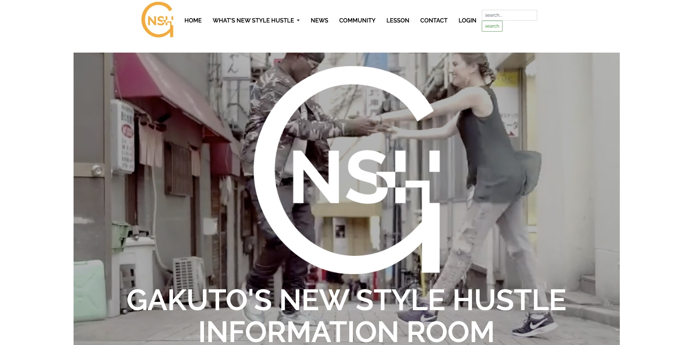

# GAKUTOのニュースタイルハッスル情報部屋



📍 サイトURL：<a href="https://gakuto-newstylehustle.com" target="_blank">https://gakuto-newstylehustle.com</a>


## 🔍 サイト概要

「GAKUTOのニュースタイルハッスル情報部屋」は、日本における New Style Hustle（ニュースタイルハッスル）を紹介する情報サイトです。<br>
New Style Hustleとは、ストリートの要素が大きい比較的新しいペアダンスです。<br>
※本サイトは、当初は公共的な情報サイトを目指しておりましたが、運営方針や表現内容の調整を経て、現在は個人の視点を中心とした内容となっております。


## 🧭 主なページ構成

| ページ名   | 内容 |
|------------|------|
| HOME       | サイトの紹介・イントロダクション |
| ABOUT      | ニュースタイルハッスルとサイトの目的紹介 |
| LESSON     | 東京でのレッスン・練習会情報 |
| COMMUNITY  | 全国のコミュニティ一覧（都道府県別） |
| CONTACT    | お問い合わせフォーム |
| LOGIN      | ユーザーログイン機能 |
| 登録        | ユーザー新規登録ページ |


## 🛠 技術構成

- **PHP**：8.4.x（`composer.json`：`^8.4`）
- **開発フレームワーク**：Laravel 13.x（現在のロックバージョン：13.38.0）
- **テストフレームワーク**：PHPUnit 12.5.x
- **使用言語**：PHP / HTML / CSS / JavaScript  
- **テンプレートエンジン**：Blade  
- **ホスティング環境**：エックスサーバー（PHP 8.4.x／Laravel 13.x）
- **ローカルデータベース**：SQLite
- **本番データベース**：MySQL
- **レスポンシブ対応**：モバイル表示に配慮した設計


## 🚀 本番環境

本アプリケーションはPHP 8.4／Laravel 13へアップグレードし、エックスサーバーの本番環境で運用しています。


## 💻 ローカルでの起動

PHP 8.4、Composer、SQLite拡張が必要です。macOSでHomebrewのPHP 8.4を使う場合は、先に次のようにPATHを設定します。

```bash
export PATH="/usr/local/opt/php/bin:$PATH"
php -v
```

その後、以下を実行します。

```bash
composer install
cp .env.example .env
touch database/database.sqlite
php artisan key:generate
php artisan migrate
php artisan serve
```

`http://127.0.0.1:8000` を開くと、SQLiteを使ったローカル環境で確認できます。本番環境では既存のMySQL接続情報を `.env` に設定してください。


## ✨ 特徴・工夫点

- **ニッチなジャンルに特化**：New Style Hustle に関する日本語リソースが少ない中、体系的な情報整理を実現  
- **読みやすさへの配慮**：初心者でも理解しやすい日本語表現とシンプルなレイアウト  
- **全国展開を視野に**：都道府県別のコミュニティ情報を網羅し、地方のユーザーにも配慮  


## 🚀 ポートフォリオとしてのポイント

- フルスクラッチでのWebサイト構築経験  
- Laravelによるルーティング・ビュー・バリデーションなど一通りの構成要素に触れた経験  
- 実サービスとして公開し、ユーザーがアクセスできるプロダクトを運用中


## ℹ️ 補足情報

本サイトは、2019年にプログラミングスクールの制作課題として、Web開発の基礎力や情報整理力を示すために個人で構築・公開したポートフォリオです。
